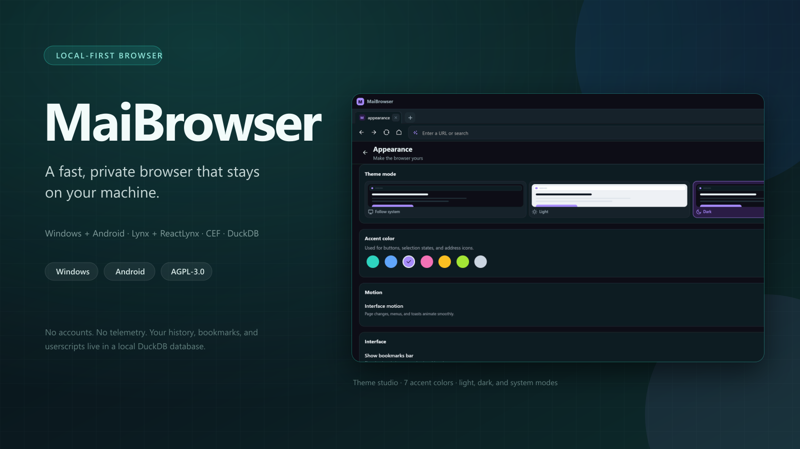
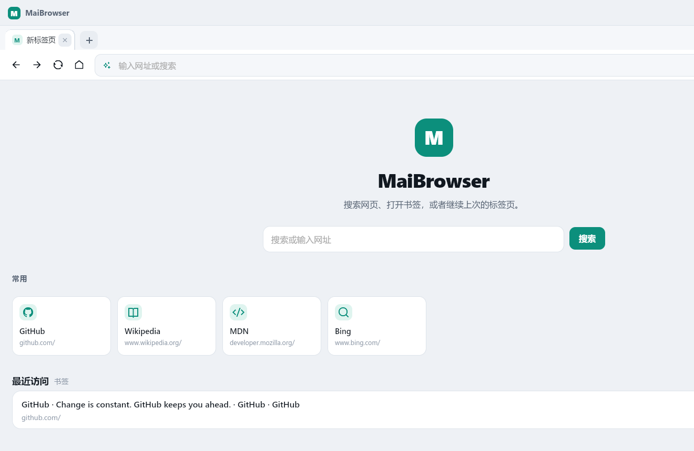
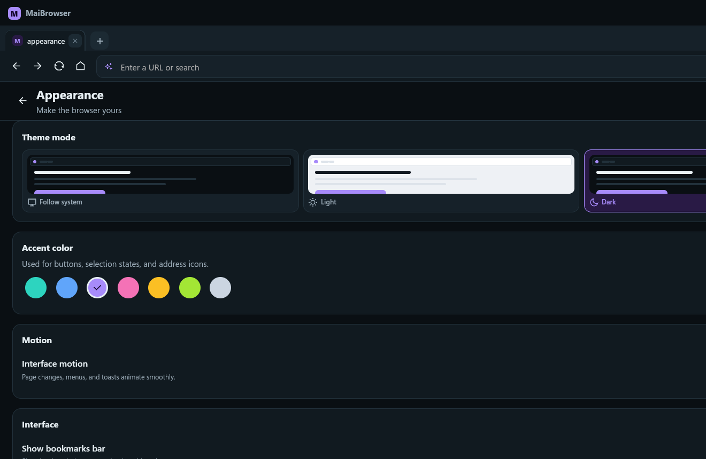
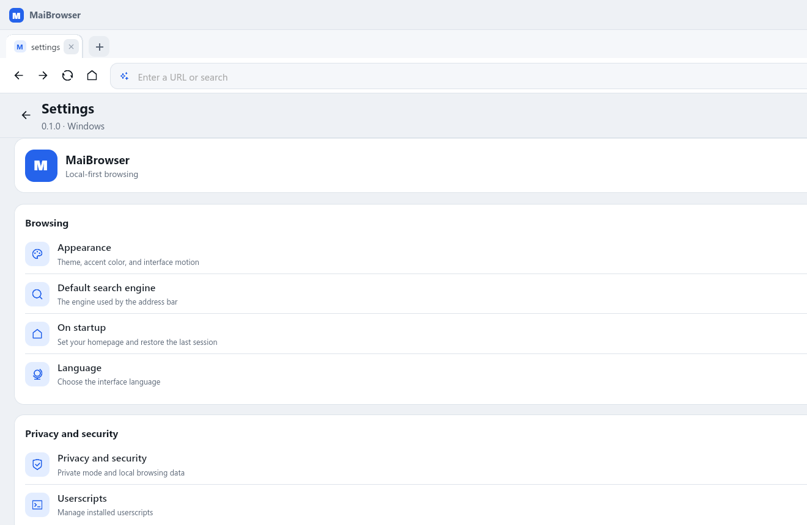
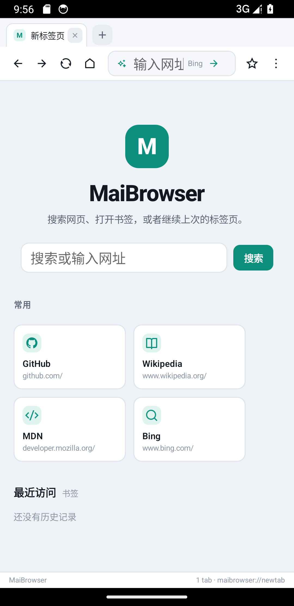

<div align="center">
  
</div>

<h1 align="center">MaiBrowser</h1>

<p align="center">
  <strong>A local-first browser for Windows and Android, built with Lynx and ReactLynx.</strong>
</p>

<p align="center">
  One shared browser UI · CEF on Windows · system WebView on Android · DuckDB on desktop
</p>

<p align="center">
  <a href="https://github.com/Maicarons/MaiBrowser/releases/tag/v0.2.0"></a>
  <a href="LICENSE"></a>
  <a href="https://github.com/Maicarons/MaiBrowser/releases"></a>
  <a href="https://maicarons.github.io/MaiBrowser/"></a>
  <a href="https://github.com/Maicarons/MaiBrowser/releases"></a>
</p>

<p align="center">
  <a href="#install">Install</a> ·
  <a href="#screenshots">Screenshots</a> ·
  <a href="https://maicarons.github.io/MaiBrowser/">Documentation</a> ·
  <a href="docs/guide/v0.2-plan.md">Roadmap</a> ·
  <a href="README_zh.md">简体中文</a>
</p>

MaiBrowser is an early-stage browser that keeps its data on your machine. The browser shell is a native Lynx view rather than a web app: the same ReactLynx components run on Windows through Lynxtron and CEF, and on Android through Sparkling and the system WebView.

Version 0.2.0 is the current public release. Version 0.1.0 introduced the shared tabbed UI, history, bookmarks, download records, userscripts, themes, and local storage on both platforms. 0.1.1 corrected the English motion hint, and 0.1.2 added cached `@require` / `@resource` support plus atomic Android state snapshots. 0.2.0 adds a multi-connection download manager on Windows, download controls and progress in the shared UI, and system DownloadManager support on Android. The Windows installer is not code-signed, and the Android APK is debug-signed; both are suitable for evaluation rather than production distribution.

## Install

### Windows

- **Download:** [MaiBrowser v0.2.0 for Windows x64](https://github.com/Maicarons/MaiBrowser/releases/download/v0.2.0/MaiBrowser-v0.2.0-win-x64-Setup.exe)
- **Requirements:** Windows 10 or 11, x64
- **Notes:** The NSIS installer is unsigned, so Windows SmartScreen may show a warning. Verify the download against `SHA256SUMS.txt` before running it.

### Android

- **Download:** [MaiBrowser v0.2.0 APK](https://github.com/Maicarons/MaiBrowser/releases/download/v0.2.0/MaiBrowser-v0.2.0-android-debug.apk)
- **Requirements:** Android 7.0 (API 24) or newer
- **Notes:** The APK is debug-signed and is not distributed through Google Play. Enable installation from unknown sources for your browser or file manager, then open the APK. It supports `armeabi-v7a` and `arm64-v8a`.

Release files and checksums live on the [releases page](https://github.com/Maicarons/MaiBrowser/releases/tag/v0.2.0).

## Screenshots

|                                                     New tab                                                      |                                                         Theme studio                                                         |                                              Settings                                              |
| :--------------------------------------------------------------------------------------------------------------: | :--------------------------------------------------------------------------------------------------------------------------: | :------------------------------------------------------------------------------------------------: |
|  |  |  |

<p align="center">
  
</p>

## Highlights

**One UI, two engines.** Tabs, the address bar, history, bookmarks, downloads, settings, and script management live in `packages/ui` and are shared by both platforms. Only the shell and web engine adapters are platform-specific.

**A browser that feels native.** The chrome is rendered by Lynx 4.x and ReactLynx with `@lynx-js/lynx-ui`, not by a hidden browser window. Page content is hosted by CEF on Windows and by the system WebView on Android.

**Everyday browsing.** Pinned tabs, reopen closed tab, private tabs, address-bar autocomplete from history and bookmarks, find in page, zoom, print, a bookmarks bar, and bookmark HTML import/export on desktop.

**Themes that stay out of the way.** Light, dark, and follow-system modes, seven accent colors, compact page transitions, and a motion switch. Content is never hidden while an animation runs.

**Userscripts without an extension runtime.** MaiBrowser parses Tampermonkey metadata, matches `@match`, `@include`, and `@exclude`, caches text `@require` / `@resource` dependencies, and provides a `GM_*` / `GM.*` bridge for values, XHR, resources, and menus. Scripts can be installed, enabled, disabled, updated, and removed from the built-in manager.

**Downloads that finish.** Explicit download links and `GM_download` calls enter a desktop download manager built on `ipull`: four parallel range connections, progress, pause, resume, cancel, and retry. Android delegates to the system DownloadManager and syncs status back into the same download page.

**Local-first storage.** On Windows, history, bookmarks, downloads, userscripts, script values, and tab sessions are stored in a local DuckDB database. Android keeps the equivalent state in a private JSON snapshot. There are no accounts, no cloud sync, and no telemetry.

## Architecture

| Concern    | Windows                                   | Android                               |
| ---------- | ----------------------------------------- | ------------------------------------- |
| Browser UI | Lynx 4.x · ReactLynx · `@lynx-js/lynx-ui` | The same shared UI                    |
| Shell      | Lynxtron                                  | Sparkling                             |
| Web engine | CEF via `@lynx-js/cef-webview`            | System WebView via `xelement-webview` |
| Storage    | DuckDB via `@duckdb/node-api`             | App-private JSON snapshot             |
| Packaging  | NSIS via `lynxtron-builder`               | Gradle debug APK                      |

```text
apps/desktop             Lynxtron shell, main-process RPC, CEF setup
apps/android             Sparkling app, Lynx 4.2, system WebView
packages/core            Tabs, URLs, search, and other pure models
packages/ui              Shared browser chrome and internal pages
packages/storage         DuckDB adapter and SQL migrations
packages/userscript      Tampermonkey metadata, matching, GM bridge
packages/i18n           English and Simplified Chinese strings
packages/engine-contract Browser engine interface
docs                     VitePress documentation
test-pages               Local pages for manual engine tests
```

## Development

### Requirements

- Windows 10 or 11
- [Bun](https://bun.sh/) 1.3 or newer
- Node.js 22.18 or newer
- Visual Studio 2022 with the C++ desktop workload for the CEF and Lynxtron native dependencies
- JDK 17, Android SDK, and Gradle 8.2 for Android builds; the Sparkling navigation library also needs JDK 11 available to Gradle

CEF is large. If the native package download is slow or blocked, set `npm_config_custom_cef_webview_binary_url` to a reachable mirror before installing dependencies.

```bash
bun install
bun run dev              # Lynx + Lynxtron development mode
bun run check            # typecheck, lint, and tests
bun run build            # build the Lynx bundle and desktop main process
bun run --cwd apps/desktop start   # start the desktop app after a build
bun run --cwd apps/desktop pack    # build the Windows NSIS installer
bun run docs:dev         # local documentation site
bun run docs:build       # static documentation build
```

If the Lynxtron or CEF postinstall step did not run, execute the package's install script inside its directory:

```bash
node install.js
node scripts/install.js
```

Android build instructions, JDK selection, emulator setup, and WebView debugging are documented in the [Android guide](docs/guide/android.md).

## Data and privacy

- **Windows database:** `%APPDATA%\@maibrowser\desktop\maibrowser.duckdb`
- **Windows downloads:** `MaiBrowser` inside your system Downloads folder
- **Android state:** app-private `files/maibrowser-state.json`
- **Android downloads:** `MaiBrowser` inside the system Downloads folder, managed by DownloadManager

MaiBrowser does not include accounts, cloud sync, telemetry, an ad blocker, or a password manager. Userscripts can read and modify the pages they match, so install them with the same care you would use in any browser. Android stores its state snapshot unencrypted inside the Android app sandbox, and its userscript bridge is a beta page-world design rather than a full sandbox.

## Known limitations in 0.2.0

- Desktop downloads are started from explicit `<a download>` links or `GM_download`; CEF still exposes no native download event, so form POSTs, `blob:` URLs, and PDF-viewer downloads are not intercepted. Desktop downloads do not carry CEF cookies, so authenticated links may fail.
- Private tabs do not isolate cookies. They only avoid writing history and session state.
- Multi-window browsing, site permission prompts, certificate error pages, and an auto-update UI are not implemented.
- Android bookmark import/export and DuckDB storage are not available; Android downloads are managed by the system service without pause/resume controls.
- Userscripts are injected after page load rather than at the true document start. On Android the bridge is a beta page-world design.
- After choosing an address-bar suggestion on some Android devices, navigation succeeds but the native input may not immediately show the final URL.
- The Windows installer is unsigned and the Android APK is debug-signed.

The [v0.2 research](docs/guide/v0.2-plan.md) covers the upstream CEF download, permission, and request-context work still ahead.

## Contributing

Issues and pull requests are welcome. Before opening a pull request, run:

```bash
bun run check
bun run docs:build
```

Keep platform-specific behavior behind the engine contract where possible, add tests for pure logic and storage changes, and describe any manual Windows or Android verification in the pull request. The project is maintained on a best-effort basis; there is no CLA.

## License

Copyright (C) 2026 MaiBrowser contributors.

MaiBrowser is released under the [GNU Affero General Public License v3.0](LICENSE). The documentation is licensed under the same terms.
