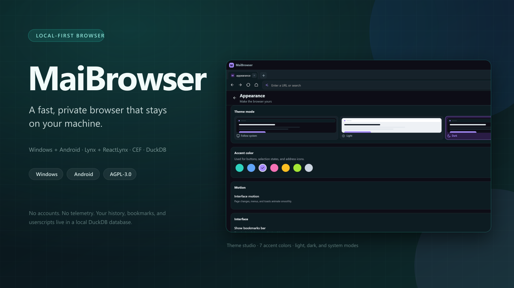
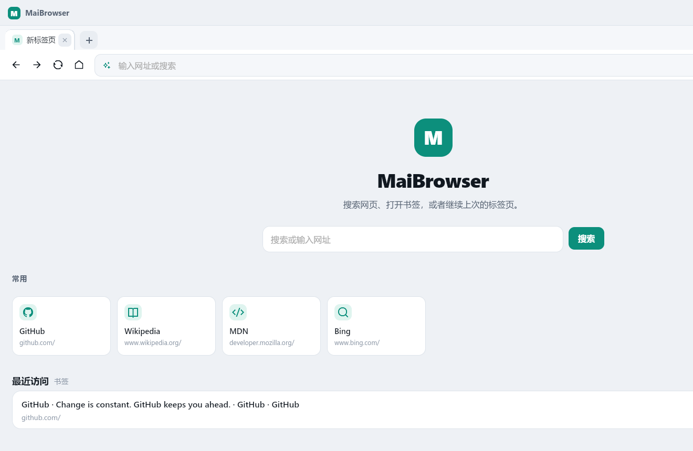
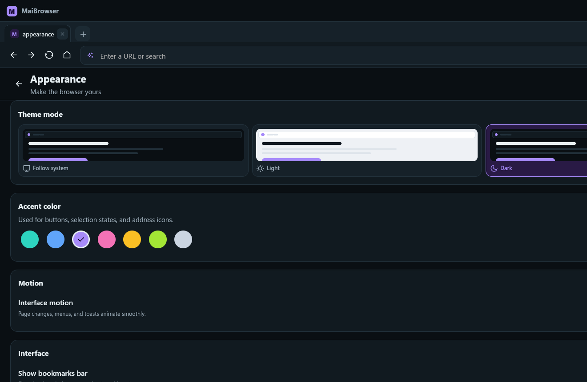
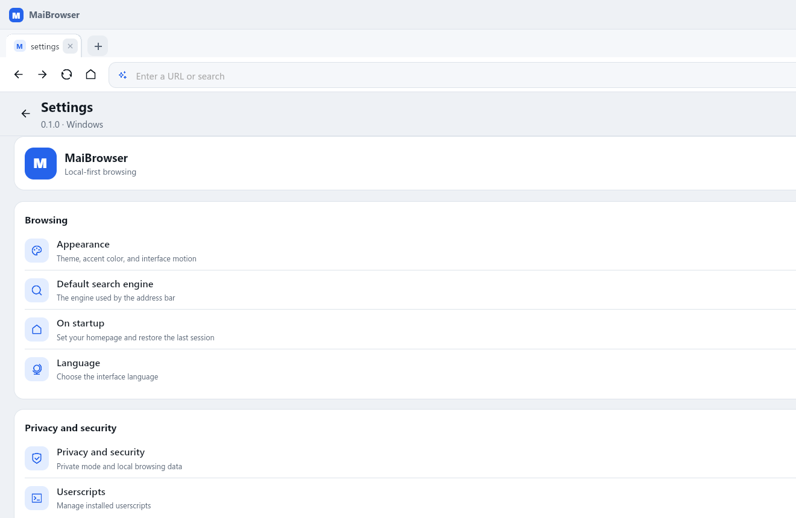
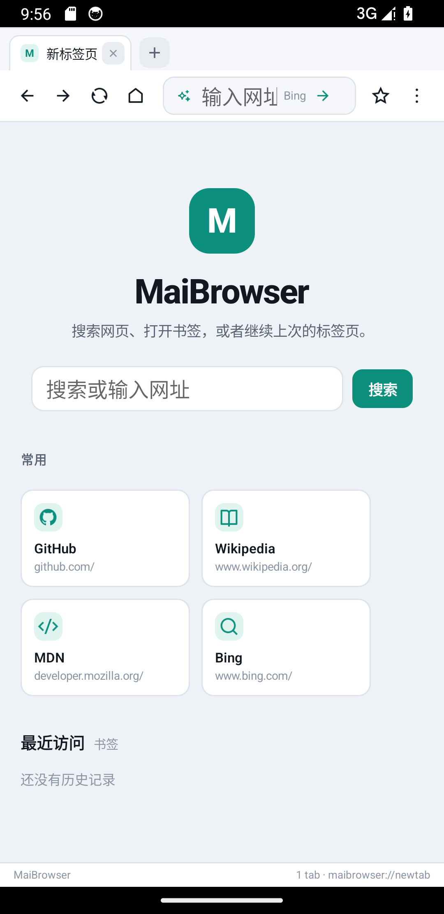

<div align="center">
  
</div>

<h1 align="center">MaiBrowser</h1>

<p align="center">
  <strong>面向 Windows 与 Android 的本地优先浏览器，使用 Lynx 与 ReactLynx 构建。</strong>
</p>

<p align="center">
  一套共享浏览器 UI · Windows 使用 CEF · Android 使用系统 WebView · 桌面端使用 DuckDB
</p>

<p align="center">
  <a href="https://github.com/Maicarons/MaiBrowser/releases/tag/v0.1.0"></a>
  <a href="LICENSE"></a>
  <a href="https://github.com/Maicarons/MaiBrowser/releases"></a>
  <a href="https://maicarons.github.io/MaiBrowser/"></a>
  <a href="https://github.com/Maicarons/MaiBrowser/releases"></a>
</p>

<p align="center">
  <a href="#安装">安装</a> ·
  <a href="#截图">截图</a> ·
  <a href="https://maicarons.github.io/MaiBrowser/">文档</a> ·
  <a href="docs/guide/v0.2-plan.md">路线图</a> ·
  <a href="README.md">English</a>
</p>

MaiBrowser 是一个仍处于早期阶段的浏览器，数据默认留在本机。浏览器外壳不是 Web 应用，而是原生 Lynx 视图：同一套 ReactLynx 组件在 Windows 上通过 Lynxtron 与 CEF 运行，在 Android 上通过 Sparkling 与系统 WebView 运行。

0.1.0 是首个公开版本，包含共享的标签页 UI、历史、书签、下载记录、油猴脚本、主题和本地存储。Windows 安装包未签名，Android APK 为调试签名；当前版本适合评估和试用，尚不适合作为生产分发版本。

## 安装

### Windows

- **下载：** [MaiBrowser v0.1.0 Windows x64](https://github.com/Maicarons/MaiBrowser/releases/download/v0.1.0/MaiBrowser-v0.1.0-win-x64-Setup.exe)
- **要求：** Windows 10 或 11，x64
- **说明：** NSIS 安装包未签名，Windows SmartScreen 可能提示风险。运行前请使用 `SHA256SUMS.txt` 校验下载文件。

### Android

- **下载：** [MaiBrowser v0.1.0 APK](https://github.com/Maicarons/MaiBrowser/releases/download/v0.1.0/app-debug.apk)
- **要求：** Android 7.0（API 24）或更高版本
- **说明：** APK 为调试签名，未上架 Google Play。请在浏览器或文件管理器中允许“安装未知应用”，然后打开 APK。支持 `armeabi-v7a` 与 `arm64-v8a`。

安装包、APK 与校验文件均位于 [Releases 页面](https://github.com/Maicarons/MaiBrowser/releases/tag/v0.1.0)。

## 截图

|                                                新标签页                                                 |                                                  主题工作室                                                  |                                           设置                                            |
| :-----------------------------------------------------------------------------------------------------: | :----------------------------------------------------------------------------------------------------------: | :---------------------------------------------------------------------------------------: |
|  |  |  |

<p align="center">
  
</p>

## 特性

**一套 UI，两端复用。** 标签页、地址栏、历史、书签、下载、设置和脚本管理都位于 `packages/ui`，由两端共享；只有外壳与网页引擎适配层按平台实现。

**原生浏览器外壳。** 浏览器 UI 由 Lynx 4.x、ReactLynx 和 `@lynx-js/lynx-ui` 渲染，而不是藏一个 Web 页面作为外壳。网页内容在 Windows 上由 CEF 承载，在 Android 上由系统 WebView 承载。

**日常浏览。** 标签固定、恢复关闭的标签、隐私标签、地址栏历史/书签补全、页内查找、缩放、打印、书签栏，以及桌面端的书签 HTML 导入/导出。

**克制的主题系统。** 支持浅色、深色、跟随系统、7 种强调色、紧凑的页面过渡和动效开关。动画不会以隐藏内容为代价。

**无需扩展运行时的油猴脚本。** 解析 Tampermonkey 元数据，支持 `@match`、`@include`、`@exclude`，并提供用于值存储、XHR 和菜单的 `GM_*` / `GM.*` 桥接。脚本可在内置管理页中安装、启停、检查更新和删除。

**本地优先存储。** Windows 端的历史、书签、下载记录、脚本、脚本值和标签页会话保存在本地 DuckDB 数据库中；Android 0.1.0 使用应用私有目录中的 JSON 状态快照。没有账号、没有云同步、没有遥测。

## 架构

| 层        | Windows                                   | Android                            |
| --------- | ----------------------------------------- | ---------------------------------- |
| 浏览器 UI | Lynx 4.x · ReactLynx · `@lynx-js/lynx-ui` | 同一套共享 UI                      |
| 外壳      | Lynxtron                                  | Sparkling                          |
| 网页引擎  | CEF（`@lynx-js/cef-webview`）             | 系统 WebView（`xelement-webview`） |
| 存储      | DuckDB（`@duckdb/node-api`）              | 应用私有 JSON 快照                 |
| 打包      | `lynxtron-builder` 生成 NSIS 安装包       | Gradle 调试 APK                    |

```text
apps/desktop             Lynxtron 外壳、主进程 RPC、CEF 初始化
apps/android             Sparkling 应用、Lynx 4.2、系统 WebView
packages/core            标签页、URL、搜索等纯函数模型
packages/ui              共享浏览器外壳与内部页面
packages/storage         DuckDB 适配层与 SQL 迁移
packages/userscript      Tampermonkey 元数据、匹配与 GM 桥接
packages/i18n            中英文文案
packages/engine-contract 浏览器引擎接口
docs                     VitePress 文档
test-pages               本地测试页面
```

## 开发

### 环境要求

- Windows 10 或 11
- [Bun](https://bun.sh/) 1.3 或更高版本
- Node.js 22.18 或更高版本
- Visual Studio 2022 的 C++ 桌面开发工作负载（用于 CEF/Lynxtron 原生依赖）
- Android 构建需要 JDK 17、Android SDK 和 Gradle 8.2；Sparkling 导航库还需要 Gradle 能找到 JDK 11

CEF 体积较大。如果原生包下载缓慢或被阻断，可在安装依赖前把 `npm_config_custom_cef_webview_binary_url` 指向可访问的镜像。

```bash
bun install
bun run dev              # 启动 Lynx + Lynxtron 开发模式
bun run check            # 类型检查、Lint 与测试
bun run build            # 构建 Lynx bundle 与桌面主进程
bun run --cwd apps/desktop start   # 构建后启动桌面应用
bun run --cwd apps/desktop pack    # 生成 Windows NSIS 安装包
bun run docs:dev         # 本地文档站点
bun run docs:build       # 构建静态文档
```

如果 Lynxtron 或 CEF 的 postinstall 没有执行，可在对应包目录运行：

```bash
node install.js
node scripts/install.js
```

Android 的构建、JDK 选择、模拟器配置与 WebView 调试方法见 [Android 指南](docs/guide/android.md)。

## 数据与隐私

- **Windows 数据库：** `%APPDATA%\@maibrowser\desktop\maibrowser.duckdb`
- **Windows 下载目录：** 系统下载目录下的 `MaiBrowser`
- **Android 状态：** 应用私有目录 `files/maibrowser-state.json`
- **Android 下载：** 0.1.0 仅记录元数据，尚未接入文件写入

MaiBrowser 不包含账号、云同步、遥测、广告拦截器或密码管理器。油猴脚本可以读取和修改其匹配的页面，请像对待其他浏览器中的脚本一样谨慎安装。Android 0.1.0 的状态快照未加密，依赖 Android 应用沙箱保护；其油猴桥接是页面世界 + 窄桥接的 beta 方案，不是完整沙箱。

## 0.1.0 已知限制

- 下载尚未接入 CEF 或 Android 的下载管理器，下载页目前只管理记录。
- 隐私标签不隔离 Cookie，只避免写入历史与会话。
- 多窗口、站点权限提示、证书错误页面和自动更新 UI 尚未实现。
- Android 端暂不支持书签导入/导出、文件下载和 DuckDB 存储。
- 油猴脚本在页面加载后注入，不是严格的文档起点；Android 端桥接仍为 beta。
- 在部分 Android 设备上，通过地址栏补全选中地址后页面会正确导航，但原生输入框可能不会立即回填最终 URL。
- Windows 安装包未签名，Android APK 为调试签名。

更完整的下载、权限提示、Android 对齐、发布工程与存储决策见 [v0.2 规划](docs/guide/v0.2-plan.md)。

## 参与贡献

欢迎提交 Issue 和 Pull Request。提交 PR 前请运行：

```bash
bun run check
bun run docs:build
```

平台相关行为尽量收敛在引擎契约之后；纯逻辑和存储改动请补充测试；涉及 Windows 或 Android 的改动，请在 PR 中说明手动验证过程。项目按尽力而为的方式维护，不要求签署 CLA。

## 许可证

Copyright (C) 2026 MaiBrowser contributors.

MaiBrowser 以 [GNU Affero General Public License v3.0](LICENSE) 发布，文档使用同一许可证。
